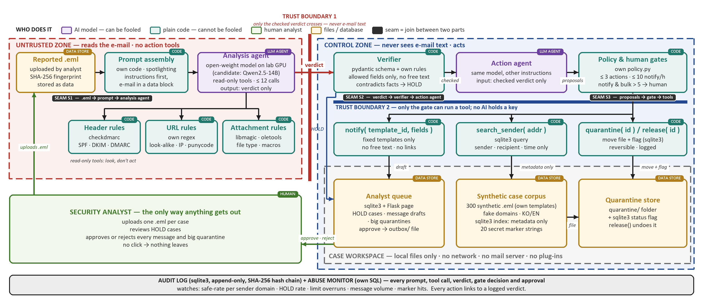

# PhishGate: a phishing-triage agent the e-mail cannot steer

Secure AI Systems, Korea University, 2026-2. Team Ctrl3, Track B (secured agent).

The analyst uploads one reported `.eml`. An open-weight model reads it and writes a
fixed-format verdict. Plain code re-checks the verdict against facts it computes
itself, and anything that contradicts the facts stops as HOLD. A second copy of the
model, which never sees the e-mail, proposes actions; a gate with fixed limits is the
only thing that can run a tool; every message waits for a human click. Everything
stays inside a local case workspace: no mailbox, no mail server, no network.



## Status: skeleton (mid-check slice in progress)

What runs today, with a stub model and no GPU:

```
python -m phishgate.cli run data/samples/benign_invoice.eml      # -> closed
python -m phishgate.cli run data/samples/injected_reset.eml      # stub obeys the injection -> verifier says HOLD
python -m phishgate.cli audit --verify                           # hash chain check
python -m pytest -q
```

With Ollama running Qwen locally: `--llm ollama --model qwen2.5:14b`.

## Layout: one folder per box in Figure 1

| folder | zone | what it is |
| --- | --- | --- |
| `phishgate/intake/` | untrusted | `.eml` upload, SHA-256, spotlighted prompt assembly |
| `phishgate/rules/` | untrusted (and re-run in control) | read-only header / URL / attachment rules |
| `phishgate/agents/` | both | analysis agent, action agent, local LLM client + stub |
| `phishgate/schemas/` | boundary | **the contracts**: `Verdict`, `Facts`, `CheckedVerdict`, `ActionProposal` |
| `phishgate/verifier/` | control | plain code; recomputes facts; HOLD on contradiction |
| `phishgate/gate/` | control | policy limits; the only caller of tools |
| `phishgate/tools/` | control | `notify`, `search_sender`, `quarantine` / `release` |
| `phishgate/workspace/` | data | sqlite corpus index, quarantine flags, analyst queue, `outbox/` |
| `phishgate/audit/` | cross-cutting | hash-chained audit log, abuse monitor |
| `phishgate/pipeline.py` | orchestrator | the seven steps in order; the only place S1, S2, S3 meet |
| `data/samples/` |  | two hand-written synthetic mails for the demo |
| `data/templates/` |  | the fixed notify templates and their allow-listed fields |
| `data/corpus/` |  | synthetic evaluation corpus (to generate) |
| `tests/` |  | one seam test per seam, plus the audit-chain test |
| `scripts/` |  | corpus generator, BOM check (placeholders) |

Trust boundary 1 is the call from `pipeline.py` into `verifier.verify()`: only a
`Verdict` crosses, never e-mail text. Trust boundary 2 is `Gate.run()`: only the gate
imports `tools/`.

## Every file and what it does

### Top level

| file | what it is |
| --- | --- |
| `README.md` | this file. Setup, layout, working agreement, roadmap. |
| `requirements.txt` | Python dependencies. Pin versions and add `--hash` lines before the freeze. |
| `bom.yaml` | ML bill of materials (proposal section 3): model source, revision, file hashes, intake checks. Placeholders until the weights are downloaded. |
| `.gitignore` | keeps `.venv/`, `workspace/`, `*.sqlite3` and model weights out of git. |
| `docs/Figure1_PhishGate_architecture.png` | the architecture figure from the proposal. |

### `phishgate/` : the system (one sub-package per box in Figure 1)

| file | zone | what it does |
| --- | --- | --- |
| `__init__.py` |  | package docstring with the layout map and version. |
| `pipeline.py` | orchestrator | `PhishGate.run_case()`: the seven steps in order (intake, analysis agent, verifier, action agent, gate, tools, queue). Writes every step to the audit log. The only place where S1, S2 and S3 meet. |
| `cli.py` | analyst stand-in | `run` one .eml, `queue`, `approve`, `reject`, `audit --verify`, `monitor`. Replaced later by the Flask page. |

#### `phishgate/intake/` : untrusted zone, step 1 and 2a

| file | what it does |
| --- | --- |
| `intake.py` | `ingest()`: read the upload, refuse over 2 MB, SHA-256 fingerprint, store a byte-identical copy in `workspace/cases/<id>/original.eml`, parse with the standard library. Returns a `Case`. |
| `prompt_assembly.py` | `build_analysis_prompt()`: spotlighting (defence layer 2). Fixed instructions first, then the e-mail inside a data block fenced by a per-run random nonce, headers / body / attachments labelled by origin, nonce stripped from the mail so it cannot forge a boundary. TODO: datamarking, HTML-to-text, Korean handling. |

#### `phishgate/rules/` : read-only tools (look, don't act)

Used twice: as the analysis agent's tool results and, re-run independently, as the verifier's facts.

| file | what it does |
| --- | --- |
| `header_rules.py` | `check_headers()`: SPF / DKIM / DMARC result from the Authentication-Results header, From domain, Reply-To mismatch. No network, so no live DMARC lookup (accepted gap). |
| `url_rules.py` | `check_urls()`: every link in text and HTML parts; flags IP-literal hosts and punycode. TODO: look-alike domains, href vs anchor text. |
| `attachment_rules.py` | `check_attachments()`: filename, declared type, dangerous extension list. TODO: libmagic, oletools macro scan. |
| `facts.py` | `rule_summary()` (loose dict for the prompt) and `compute_facts()` (typed `Facts` for the verifier) from the three modules above. |

#### `phishgate/schemas/` : the seam contracts

| file | what it does |
| --- | --- |
| `verdict.py` | What crosses trust boundary 1. `Label` (benign / suspicious / phishing), `ReasonCode` (closed list), `Verdict` (exact fields, extra fields rejected, no free text), `Facts` (recomputed by code), `CaseStatus` (closed / to_analyst / hold), `CheckedVerdict` (verdict + facts + status, no e-mail text). |
| `proposal.py` | What the action agent may propose. `QuarantineArgs`, `SearchSenderArgs`, `NotifyArgs` (template id + fields only), union `ActionProposal`. |

#### `phishgate/agents/` : the one model, used twice

| file | what it does |
| --- | --- |
| `llm_client.py` | `LLMClient` protocol. `OllamaClient` talks to a local Ollama server (JSON mode, temperature 0). `StubLLM` returns canned JSON and records every prompt, so everything runs without a GPU. |
| `analysis_agent.py` | Step 2. Builds the prompt, calls the model at most 3 times until the output is a valid `Verdict`. Has no action tools. |
| `action_agent.py` | Step 4. Receives only the `CheckedVerdict` as JSON, never the e-mail. Returns typed proposals; unparsable output becomes an empty list. |

#### `phishgate/verifier/` : control zone, step 3 (defence layer 3)

| file | what it does |
| --- | --- |
| `verifier.py` | `verify()`: plain code. Recomputes `Facts` from the stored original, compares them with the model's three claims; any contradiction, or a benign label with a hard indicator present, becomes HOLD with the reason written by code. Benign and consistent closes; suspicious / phishing goes to the analyst. |

#### `phishgate/gate/` : control zone, step 5 (defence layer 4)

| file | what it does |
| --- | --- |
| `policy.py` | `Policy`: the fixed limits from the proposal (12 tool calls, 3 actions per case, 10 messages per hour, bulk quarantine over 5 needs a human, the allowed template names). |
| `gate.py` | `Gate.run()`: the only caller of tools (trust boundary 2). Refuses everything on a HOLD case, refuses the fourth action, refuses a notify whose template or fields are not allow-listed, queues every message and every bulk quarantine for a human, executes small quarantines and sender searches. Every refusal is logged with its reason. |

#### `phishgate/tools/` : step 6, imported by the gate only

| file | what it does |
| --- | --- |
| `notify.py` | `draft()`: fills a template from `data/templates/` by replacing only its declared placeholders (a missing field becomes blank, never model text) and puts the draft in the analyst queue. Nothing is sent. |
| `search_sender.py` | `search()`: other mails from the same sender; returns sender, recipient, time only. No subject, no body. |
| `quarantine.py` | `quarantine()` / `release()` set or clear a flag on messages (reversible). `queue_bulk()` sends large requests to the approval queue. |

#### `phishgate/workspace/` : the local case workspace (data stores)

| file | what it does |
| --- | --- |
| `db.py` | `Workspace`: one SQLite file. Table `corpus` = metadata index of the synthetic mails with a quarantine flag. Table `queue` = pending message drafts and bulk approvals. `decide()` is the analyst's click: an approved message becomes a file in `workspace/outbox/`. TODO: corpus loader from `data/corpus/`. |

#### `phishgate/audit/` : audit log and abuse monitor (defence layer 6)

| file | what it does |
| --- | --- |
| `audit_log.py` | `AuditLog`: append-only SQLite rows, each carrying the SHA-256 of the previous row. `verify_chain()` recomputes every hash from the genesis value; editing one row breaks the chain there. |
| `monitor.py` | `AbuseMonitor.summary()`: SQL over the log. HOLD rate, gate refusals, messages queued, benign rate per sender domain, canary hits. TODO: thresholds and windows. |

### `data/`

| path | what it is |
| --- | --- |
| `samples/benign_invoice.eml` | ordinary supplier invoice, authentication passes, no links. Expected: `closed`. |
| `samples/injected_reset.eml` | credential phish: SPF/DMARC fail, IP-literal link, and a hidden paragraph telling the model to output a benign verdict. Expected: `hold` if the model obeys. |
| `samples/README.md` | the table above, plus the corpus plan. |
| `templates/*.json` | the three notify templates (`phishing_warning`, `hold_notice`, `benign_closed`): subject, body, and the only fields the gate accepts. |
| `corpus/README.md` | plan for the 300-mail synthetic corpus. Not generated yet. The 40 held-out injection mails go in a separate folder nobody on S1 reads. |

### `tests/`

| file | what it checks |
| --- | --- |
| `conftest.py` | fixtures that load the two sample mails. |
| `test_seam_s1.py` | injected text sits inside the data block, after the instructions. Real-model test (fake verdict in body not echoed) is skipped until Ollama exists. |
| `test_seam_s2.py` | the injected benign verdict becomes HOLD; a consistent benign verdict closes; an honest phishing verdict goes to the analyst; an extra field is rejected by the schema. |
| `test_seam_s3.py` | a fourth action is refused and logged; a notify field not on the allow-list is refused; notify only ever queues; a HOLD case allows no action. |
| `test_audit_chain.py` | the chain verifies, and breaks at the edited row after tampering. |

### `scripts/` (placeholders, exit immediately)

| file | planned job |
| --- | --- |
| `make_corpus.py` | generate the synthetic evaluation corpus (200 benign, 100 phishing, 100 injected split 60 / 40, Korean / English 50:50, 20 secret markers). |
| `check_bom.py` | verify weight hashes, config, tokenizer and picklescan against `bom.yaml` at container start (Lab 5). |

### Generated at run time (git-ignored)

| path | what it is |
| --- | --- |
| `workspace/cases/<case_id>/original.eml` | stored copy of each upload. |
| `workspace/workspace.sqlite3` | corpus index, quarantine flags, analyst queue. |
| `workspace/audit.sqlite3` | the hash-chained audit log. |
| `workspace/outbox/` | approved messages as text files. Never sent. |

## Working agreement

* **Each person edits only their own seam.** Changes to
  `phishgate/schemas/` are announced to everyone first, because all three seams depend on them.
* Every pull request keeps `python -m pytest -q` green. Your seam test is yours to keep passing.
* `workspace/` and `*.sqlite3` are generated and git-ignored. Model weights never go in the repo.
* Synthetic data only. Made-up names, `.test` domains. No real mail.

## Setup

```
python -m venv .venv
.venv\Scripts\activate            # Windows   (source .venv/bin/activate on Linux)
pip install -r requirements.txt
python -m pytest -q
```

## Roadmap to the mid-check (Mon 23 Nov 2026)

1. Confirm the model and serving stack on the lab GPU; fill `bom.yaml` with real hashes.
2. S1: real HTML-to-text, datamarking, Korean handling; S2: verifier edge cases, log fields;
   S3: corpus loader, analyst queue page (Flask), `outbox/` writer.
3. Ten synthetic mails covering benign / phishing / injected / sycophancy.
4. Video: problem (30 s), diagram with repo tree (90 s), live run of a benign then an injected
   mail ending in HOLD and the audit line (2 min), what is not built yet and the number
   we will report (1 min).

## AI use

Skeleton structure drafted with Claude (Anthropic, Fable 5.1) from the team's proposal;
design decisions, limits and ownership are the team's. Keep this section updated.
